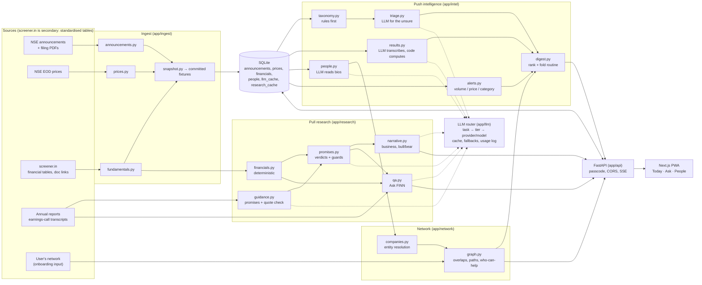

# FINN architecture

FINN is a FastAPI backend with SQLite and a Next.js mobile web app. Data pipelines run ahead of time and write to SQLite; the API serves a ranked brief, research views and network lookups; the LLM is used only where reading or judgement is needed, and never for arithmetic.

## Data pipelines
- **Ingest** pulls NSE announcements (with PDFs), NSE end-of-day prices and screener.in tables for the demo universe. `snapshot.py` writes them to `backend/data/fixtures/`, and `make seed` rebuilds SQLite from those fixtures in about 2.5 seconds. The demo never depends on live scraping (NFR-02). Scrapers are rate-limited to 1 request per second per host and cache everything (NFR-11).
- **Enrichment** (`app/intel/enrich.py`) runs once per new filing:
  - rules classify it first, and the LLM triages only what the rules are unsure about;
  - results filings are transcribed by the LLM, then code converts units, computes EBITDA, QoQ and YoY, and cross-checks against screener;
  - management changes get a bio read from the filing.
  - Output is committed to `enrichment.json`.
- **Entity resolution** from a filing name to the network: company names are normalised with aliases (`companies.py`), and a filing person becomes a graph node whose employers and schools are matched against the user's contacts. Paths are 1st or 2nd degree, with link strength.
- **Research** (`app/research/service.py`) for a ticker:
  - screener tables feed the deterministic sections;
  - the latest annual report and the last 4 earnings calls are downloaded and split into pages;
  - guidance extraction, promised-vs-delivered, business snapshot and bull/bear are written by the LLM;
  - "who can help" is attached at read time.
  - Views are cached by (ticker, document set, prompt version). An incomplete view is never cached.
- **Brokerage reports** (`app/brokerage/`): `ingest.py` fetches reports from the brokers' own public servers (listed in `fixtures/brokerage/sources.json`), `extract.py` reads each into a schema with evidence and checks it against the page text, `store.py` saves it insert-only (deduplicated by content hash), `calc.py` holds every formula (implied return, percentiles, revisions, momentum, dispersion, point-in-time evaluation) and `service.py` shapes the API. Uploads (`jobs.py`) run in a background thread with recorded stages and are scoped to the uploader's space.

## LLMs and agents
Every call names a **task**; `config/models.yaml` maps tasks to a tier and tiers to a model per provider. `LLM_PROVIDER=anthropic` switches everything to Claude with no code change. Every call is cached in SQLite and logged with model, tokens, latency and cache hit (`/admin/costs`).

| Step | Tier | Model on Claude | Why this tier | Measured tokens per call (in / out) | Cost per call on Claude |
|---|---|---|---|---|---|
| `triage_filings` | fast | Haiku 5.5 | High volume, simple labels; rules handle the confident ones | 5.8k / 0.75k | $0.001 |
| `extract_results` | fast | Haiku 5.5 | Copying numbers from a table; code does the maths and a cross-check catches errors | 13.3k / 0.46k | $0.002 |
| `extract_person` | fast | Haiku 5.5 | Short bio extraction; checked against a hand-labelled set (roles 7/7, employers 17/18) | 1.3k / 0.23k | $0.0002 |
| `extract_guidance` | mid | Sonnet 5.5 | Measured: flash-lite found 5 promises in one company's four calls, flash found 10 including all 3 misses | 14.2k / 1.0k | $0.04 |
| `business_snapshot`, `bull_bear` | mid | Sonnet 5.5 | Synthesis with citations | 22–28k / 0.8–0.9k | $0.05–0.07 |
| `promise_vs_delivery` | strong | Opus 5.5 | The judgement the product is built around | 4.8k / 1.2k | $0.04 |
| `extract_brokerage` | mid | Sonnet 5.5 | A 5–30 page report into a fixed schema with page and excerpt per field; code verifies every field and estimate (60/60, 285/285) | 9.0k / 2.3k | $0.04 |
| `explain_divergence` | mid | Sonnet 5.5 | Why brokerages differ, from a code-built evidence pack; points with unsourced figures dropped | not logged separately (one stored call per company) | under $0.02 |
| `answer_question` | mid | Sonnet 5.5 | Grounded Q&A over 8 retrieved pages and the numbers | 9.2k / 0.47k | $0.02 |

Prices per million tokens, from `models.yaml`: Haiku $0.10 / $0.50, Sonnet $2 / $10, Opus $4 / $20.

**Grounding rules, all enforced in code:**
- Numbers are computed, not generated (NFR-04).
- Every guidance quote is fuzzy-matched against its page and dropped if it can't be found.
- Verdicts may cite only evidence ids supplied by code.
- "Missed" before a deadline is downgraded to "too early".
- Narrative and Q&A citations must point at pages or ids that were in the prompt; uncited points are removed.
- "Not disclosed" and "the documents don't answer this" are valid outputs.
- A promise is "Revised" only when a cited management update says so; a statement with no number, direction or date gets no verdict.
- **Documents are untrusted input.** Prompts mark document text as data, not instructions. The validators above are the real defence: models only return structured data, and anything that points outside what code sent is dropped (`app/llm/safety.py`).

**What is agent-like and what isn't:** nothing in FINN is an open-ended agent. Research is a fixed pipeline whose steps run in parallel where possible, and Ask FINN is retrieval plus one grounded call. That is deliberate. Every step is testable, cacheable and cheap, and the place where judgement matters (promised vs delivered) gets the strongest model.

**Fallbacks:** on a daily-quota error the router moves to the next model configured for that tier and skips the exhausted one for an hour. The model that actually answered is recorded per section and shown in the app's AI labels.

## Security and privacy
- **Network data never goes to an LLM.** Paths, overlaps, who-can-help and nudges are computed in code. LLM calls carry public exchange filings, public annual reports and transcripts, and the user's question. When a filing person is resolved, only their name, roles and schools from the public filing are involved (NFR-06).
- **Profile fields only:** name, employers with dates, schools, relationship, last contact and notes the user typed. No contact details are needed for any feature.
- **Consent:** contacts are user-supplied. A production version would import from official LinkedIn APIs or a user's own data export, never by scraping. The demo network is synthetic.
- **Retention (production policy):** a contact is deleted when the user removes it; bios of people from filings are refreshed from source and expire after 90 days.
- **Demo security:** secrets live only in env vars (`.env` is gitignored); CORS is locked to the web app's origin; every API route needs the demo passcode; live analyses and questions have daily caps.
- **Production:** per-user data encrypted at rest, with row-level access control so one user's network is never readable by another (Postgres RLS keyed on user id). Network data is never written to shared stores or caches. LLM providers are used under zero-retention terms where offered.

## Cloud
| Today (demo) | Production |
|---|---|
| Render free web service: Docker image with SQLite seeded at build time | Managed Postgres with row-level security; the API on an autoscaled container service |
| Vercel: the Next.js app | Same |
| Fixtures refreshed by running the ingest scripts | A queue and workers for ingestion; a scheduled job after market close for prices and alerts; filings polled every few minutes in market hours |
| LLM results cached in SQLite | Shared cache for public-document results (filings are the same for every user); per-user data kept separate |

## Path to production
The demo serves a frozen snapshot, so three things that a live product needs were left out on purpose. Each has the moment it becomes necessary and what changes then.

| What | Needed when | What changes |
|---|---|---|
| **Incremental ingestion** | Today has to update itself instead of being re-seeded from fixtures | A scheduled job after the close (prices, alerts) and a poller every few minutes in market hours (filings). Each new filing is enriched once and appended; the digest reads the same tables, so `intel/` doesn't change. Research views are already keyed by their inputs, so a new transcript marks a view "stale" rather than serving it as current |
| **Schema migrations** | User data (holdings, networks, alert rules, notes) has to survive a deploy; today the database is rebuilt at build time | Postgres with versioned migrations (Alembic), run before the new release takes traffic. The `ALTER TABLE` guards in `init_db` are the stopgap that works only while every table can be rebuilt from fixtures |
| **A job queue** | A company analysis (about a minute, several LLM calls) outgrows a request, or two users open the same new company at once | Builds become jobs keyed by ticker and document set, so a second request joins the running one; the stream endpoint reads job progress instead of doing the work. The daily budget and the "ask before a live read" step stay as they are |

Retrieval for Ask FINN is BM25 plus a short finance synonym list. It finds the answer page for every tuning question and 9 of 11 held-out ones (`app/research/retrieval_eval.py`), and the list made no difference on the held-out set. That is the signal for embeddings: when the held-out rate falls, or questions in the logs miss, add a dense ranker alongside BM25 and keep the same test.

## Cost
- **Spent today:** $0. The whole build ran on the Gemini free tier: 552 logged calls, 331 of them answered from cache; 1.58M input and 102k output tokens.
- **On Claude, measured per unit:**
  - a new company analysis is about $0.32 (4 guidance calls, scorecard, snapshot, bull/bear);
  - a question is about $0.02;
  - a filing is about $0.003 to triage and read.
- **Per user per day, projected:**
  - Filings and analyses are public, so their cost is shared by every user who follows the company.
  - A 20-stock portfolio with about 10 filings a day costs about $0.03 to read, shared.
  - A user asking 3 questions and opening one new company a week adds about $0.06 + $0.05.
  - **About $0.10 per active user per day**, falling as more users share the same companies.
